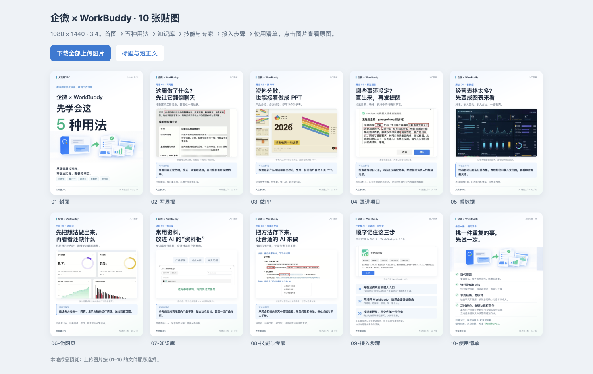

# Johnkwokskills

「大欢AI工坊」自媒体内容创作开放技能集（AI Agent Skills）。围绕商业案例拆解、AI 工具实测与科普工作流，按目标发布载体**彻底拆分为三个独立、自包含的平行技能**——互不嵌套、解压即用，兼顾内容可读性与平台发布合规性。

[下载整套套件 ZIP](packages/dahuan-suite.zip) · [安装与使用](#安装与使用) · [运行依赖](#运行依赖)

## 目录结构

```text
Johnkwokskills/
├── README.md
├── docs/                              # 各技能详解与成品示例图
│   ├── dahuan-article.md
│   ├── dahuan-image-post.md
│   └── dahuan-video.md
├── packages/                          # 开箱即用的独立 ZIP 与套件整包
│   ├── dahuan-article.zip
│   ├── dahuan-image-post.zip
│   ├── dahuan-video.zip
│   └── dahuan-suite.zip
└── skills/                            # 技能源码（每项均自带完整原则、红线与参考资料）
    ├── dahuan-article/
    ├── dahuan-image-post/
    └── dahuan-video/
```

## 三个平行技能

| 技能 | 适用载体 | 核心工作流与交付物 | 详细介绍 | 独立下载 |
|---|---|---|---|---|
| `dahuan-article` | 公众号推文长文 | 选题调研与主线策划、20 字强反差标题提炼、去 AI 味正文写作、微信内联 HTML 一键复制（Base64 JPG/GIF＋原生循环 SVG SMIL 动效）、`2.35:1` / `1:1` 双裁切封面 | [docs/dahuan-article.md](docs/dahuan-article.md) · [SKILL.md](skills/dahuan-article/SKILL.md) | [ZIP](packages/dahuan-article.zip) |
| `dahuan-image-post` | 公众号 3:4 贴图 | 将同一选题重组为 `1080×1440` 多图卡片、HTML/CSS 高清代码渲染与对比图表导出、手机宽度可读性检查、整套预览＋图片包＋短正文 | [docs/dahuan-image-post.md](docs/dahuan-image-post.md) · [SKILL.md](skills/dahuan-image-post/SKILL.md) | [ZIP](packages/dahuan-image-post.zip) |
| `dahuan-video` | 视频号创作与成片 | 动笔前四要素对齐、泥潭战友口吻口播撰写与改稿、`1080×1920` 竖屏成片制作（原片＋MG、黄金三段式大字字幕、120ms 气口、混音质检与 `1080×1440` 封面归档） | [docs/dahuan-video.md](docs/dahuan-video.md) · [SKILL.md](skills/dahuan-video/SKILL.md) | [ZIP](packages/dahuan-video.zip) |

## MG 动画创作搭档

`mg-video-director` 帮你从一个点子出发，比较创意方向、找风格案例、写时间轴分镜，并用 Remotion 在本地制作样片或成片。

[查看技能](skills/mg-video-director/SKILL.md) · [下载独立 ZIP](packages/mg-video-director.zip)

> 用 $mg-video-director 和我一起构思一条 25 秒的 MG 解说，先比较三个方向，再写出最推荐方向的开场分镜。

## 设计亮点与共同准则

- **完全独立自包含**：每个技能目录内置各自的 `principles-and-red-lines.md`、`project-records.md`、`incremental-production.md` 与经验库 `lessons.md`，单独安装任意一个都能直接工作。
- **真实证据优先，拒绝虚假包装**：产品界面、官网定价表与账单优先抓取一手截图或 HTML/CSS 编程绘制高清中文对比图，**禁止用 AI 生图模型重绘拼合含文字界面**；区分事实核验口径与自报收入，不编造亲历或实测结果。
- **如实区分交付状态**：明确区分「本地 HTML/图片预览」「剪贴板 `text/html` 检查」「公众号后台草稿保存」与「正式发布」，不拿本地截图替代平台验收。

## 成品预览




## 安装与使用

1. **安装全部三项技能**：下载 [packages/dahuan-suite.zip](packages/dahuan-suite.zip)，解压得到 `dahuan-article`、`dahuan-image-post`、`dahuan-video` 三个目录，放入 AI 助手的技能目录（如 `~/.agents/skills/` 或 `~/.codex/skills/`）。
2. **按需单独安装**：仅需某一载体时，下载对应单包 ZIP 解压放入技能目录即可，**无需任何总入口或前置父技能**。

常用触发示例：

> 使用 $dahuan-article，围绕这组材料写出 20 字内强反差标题与公众号长文，生成带 Base64 JPG/GIF 配图与原生循环 SVG 动效的一键复制 HTML 预览，并制作双裁切封面。

> 使用 $dahuan-image-post，把这篇定稿改成一组 3:4（1080×1440）公众号贴图卡片，确保手机端字号与对比图表清晰可读，交付图片包、预览与短正文。

> 使用 $dahuan-video，先对齐核心角度和前 3 秒钩子写出视频号口播稿，文字确认后按黄金三段式大字字幕与 120ms 气口标准完成 1080×1920 竖屏成片。

## 运行依赖

- 文案写作与图文整理无外部付费服务依赖；公众号 `2.35:1` 封面需助手支持图像生成能力，贴图卡片渲染导出需要可用的浏览器截图环境；
- 视频逐帧渲染需要 Python 3.10+、Playwright/Chromium 与带 `libx264` 的 `ffmpeg`，环境与脚本用法见 [rendering.md](skills/dahuan-video/references/rendering.md)；
- 公开仓库不含作者私人素材库、私有配音音色、飞书内部归档系统与账号凭据。更多写作方法可参阅 [topic-to-article.md](skills/dahuan-article/references/topic-to-article.md)、[publication.md](skills/dahuan-article/references/publication.md) 与 [spoken.md](skills/dahuan-video/references/spoken.md)。

## 许可证

本仓库目前未提供统一许可证。
