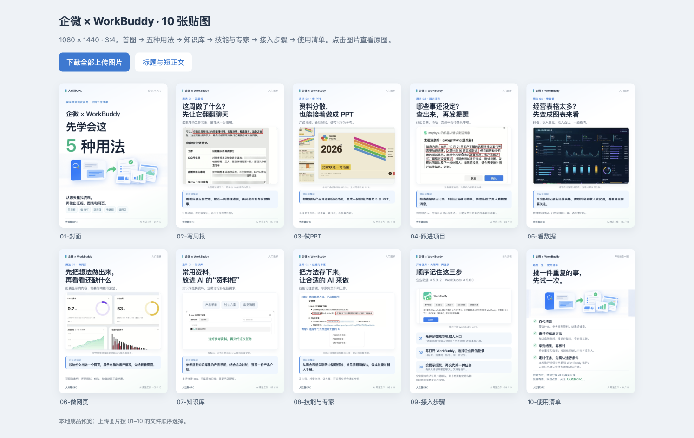

# 大欢公众号贴图（dahuan-image-post）

让读者滑过一组卡片图片，就能看清一个功能有什么用、能做出什么结果、怎样动手开始。将同一选题定稿或核实材料重组成图解卡片，默认每张 `1080×1440`、`3:4` 竖版比例。

[下载 ZIP](../packages/dahuan-image-post.zip) · [技能源码](../skills/dahuan-image-post/SKILL.md) · [套件整包](../packages/dahuan-suite.zip) · [返回套件说明](dahuan.md)

## 适用场景

> 使用 $dahuan-image-post，把这篇推文或核实资料重组成 3:4 公众号贴图，每页一个重点，突出真实截图与简洁图注，交付图片组、整套预览、压缩包与短正文。

> 使用 $dahuan-image-post，按核心对比表格用 HTML/CSS 绘制高清中文图卡并导出，不要把原网页拿去 AI 生图重绘。

> 使用 $dahuan-image-post，检查这套贴图在手机宽度（约 360–390px）下的清晰度与断行，只重导受影响的页。

## 交付清单与画面规范

- **独立自包含交付**：按上传顺序编号的高清 PNG / JPEG 图片、可点开原图的整套本地预览页、纯图片压缩包、高反差短标题与配套短正文，以及保存在工作目录中的可编辑 HTML/CSS 源码。
- **真实截图与多样性构图**：产品功能优先裁取清晰操作局部，中文对照图用 HTML/CSS 代码生成高清图像，不用 AI 生图重构带文字界面；避免每页同构框死模板，按手机可读性检查图注与数字单位。
- **渲染踩坑检查**：通过 Chromium 导出 `1080×1440` 卡片时须设置 `fullPage: true` + `clip` + `scale: 'css'` 并实际读取图片文件分辨率，防止高分屏或视口截短。

需要写公众号长文推文或 2.35:1 横方封面时使用 `dahuan-article`；需要做短视频口播或竖屏成片时使用 `dahuan-video`。未进行公众号后台上传时，只如实报告本地像素与可读性验收结果。
